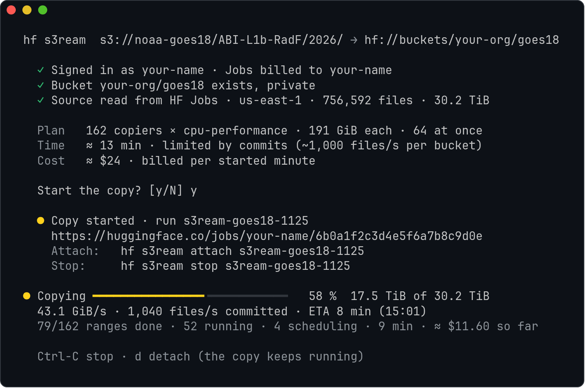
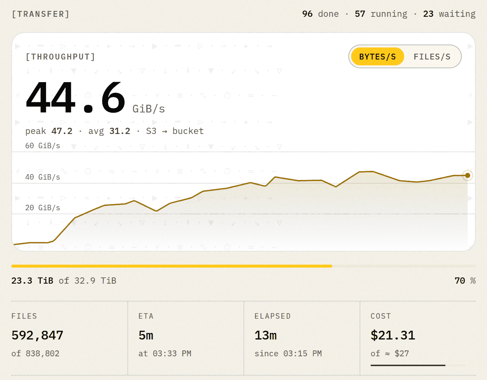

# hf-s3ream

Copy an S3 prefix into a [Hugging Face Bucket](https://huggingface.co/storage), on [HF Jobs](https://huggingface.co/docs/hub/jobs).

- **Simple.** One command, or one web page. Nothing runs on your machine.
- **Fast.** Many copier Jobs copy at the same time. Their number follows what the destination can take.
- **Cost known first.** A short dry-run shows the time and the cost before anything is copied. The Jobs are billed to your Hugging Face account.

Start it the way you prefer: **from a terminal**, with the `hf s3ream` command, or **from your browser**, with the [web Space](https://huggingface.co/spaces/glutamatt/hf-s3ream). Both start the same copy, with the same plan.

| From a terminal | From your browser |
|---|---|
|  |  |

*Left: the figures of a real copy of public NOAA data (30.2 TiB, 756,592 files, 17 min); the names are placeholders. Right: the Space's demo mode, replaying the throughput and the fleet of another real copy (32.9 TiB, 12.6 minutes in); its costs are synthetic.*

## Getting started

| | From a terminal | From your browser |
|---|---|---|
| **Start** | `hf s3ream SOURCE DEST` | the [web Space](https://huggingface.co/spaces/glutamatt/hf-s3ream) |
| **Install** | the `hf` CLI and one extension | nothing |
| **Follow the copy** | live progress in the terminal; `attach` again later, from any terminal | a live graph of the whole fleet, with the cost of each Job |
| **Good for** | scripts and agents (`--json`, `--yes`, `--max-cost`), `status` and `stop` from anywhere | no setup, watching a copy live |

### From a terminal

`hf s3ream` is an [`hf` CLI extension](https://huggingface.co/docs/huggingface_hub/guides/cli-extensions). It needs only the [`hf` CLI](https://huggingface.co/docs/huggingface_hub/guides/cli) (huggingface_hub 2.4 or later): no Docker, no Node.

```bash
hf extensions install glutamatt/hf-s3ream
hf auth login        # once
hf s3ream s3://my-bucket/prefix/ hf://buckets/your-org/your-bucket/path/to/dest
```

1. **Analyze.** A short dry-run Job lists the source on HF's side and proposes a plan with its time and cost. A missing destination bucket is created **private**. Nothing is copied yet.
2. **Confirm.** One planner Job runs the copy, and your terminal shows its live progress. `d` detaches, Ctrl-C twice stops the copy. Closing the terminal does not stop it: `hf s3ream attach RUN` follows it again, `status RUN` tells where it stands, `stop RUN` stops it.
3. **The end.** The result of the destination check, the files and bytes copied, and the cost.

To try it without AWS keys, analyze a public bucket, for example from the [AWS Open Data registry](https://registry.opendata.aws/):

```bash
hf s3ream s3://<public-bucket>/<prefix>/ hf://buckets/your-org/your-bucket --no-sign-request --analyze
```

More: [the user guide](docs/GUIDE.md#a-copy-from-a-terminal) (credentials, organizations, `--local`, agents and scripts) and [`cli/README.md`](cli/README.md) (every option).

### From your browser

Open **[huggingface.co/spaces/glutamatt/hf-s3ream](https://huggingface.co/spaces/glutamatt/hf-s3ream)**. Nothing to install: it is a static page, and your browser talks straight to the Hugging Face API.

1. **Sign in** with Hugging Face. Enter the S3 source, the destination bucket, and AWS credentials for the source.
2. **Analyze.** The same dry-run Job proposes the same plan, with its time and cost. A missing destination bucket is created **private**. Nothing is copied yet.
3. **Run copy.** One planner Job runs the copy, and the page draws the whole fleet on a live graph, with the cost of each Job. You can close the tab: the copy continues. **Stop copy** stops it.
4. **The end.** The result of the destination check, and one line for the whole fleet: Jobs, billed minutes, cost, and cost per TiB.

To try it without AWS keys, switch on **Public bucket**, enter a public bucket, for example from the [AWS Open Data registry](https://registry.opendata.aws/), and click **Analyze** only.

More: [the user guide](docs/GUIDE.md#a-copy-from-the-space).

## Adaptive concurrency

Whichever way you start it, the planner decides how many copiers run at once, while the copy runs:

- **Each copier sends as fast as it can.** It only slows down when the storage answers "slow down" (429, 5xx).
- **More copiers only while they pay.** The planner adds copiers while they add throughput, and removes some when one more copier would only add cost.
- **The fleet follows the destination, live.** It measures again and again, and grows or shrinks.

How it works, and why: [Adaptive concurrency](docs/ADAPTIVE-CONCURRENCY.md).

## Documentation

| Page | What it covers |
|---|---|
| [User guide](docs/GUIDE.md) | A copy from a terminal or from the Space, the plan, how to stop or run again a copy, AWS credentials and the minimal policy, limits |
| [`cli/README.md`](cli/README.md) | Every option of `hf s3ream`, its JSON events and exit codes, `--local` |
| [Architecture](docs/ARCHITECTURE.md) | The Jobs of a copy, the life of a copy, inside a copier, memory, code map |
| [Adaptive concurrency](docs/ADAPTIVE-CONCURRENCY.md) | How many copiers run at once, how fast each one sends, and why |
| [Design](docs/DESIGN.md) | The goals, the plan, the check at the end, and why |
| [Run the container yourself](docs/CONTAINER.md) | `docker run`, credentials, tuning knobs |
| [Contributing](CONTRIBUTING.md) | Commits, deploys, releases |

## License

Apache-2.0.
