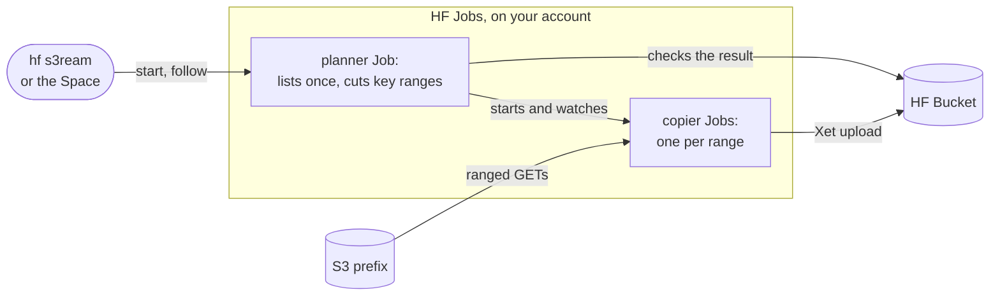

# hf-s3ream

Copy an S3 prefix into a [Hugging Face Bucket](https://huggingface.co/storage). The copy runs on [HF Jobs](https://huggingface.co/docs/hub/jobs), split across many copier Jobs, in memory: no disk staging, no machine of your own in the middle.

```bash
hf extensions install glutamatt/hf-s3ream
hf s3ream s3://my-bucket/prefix/ hf://buckets/your-org/your-bucket
```

The second command shows a plan with its time and cost, and asks before it starts anything. Then it follows the copy in your terminal. The Jobs are billed to your Hugging Face account.

No terminal, or you want to watch the copy in a browser? The [web Space](https://huggingface.co/spaces/glutamatt/hf-s3ream) starts the same copy, with the same plan.



`hf-s3ream` writes through xet-core's content-addressed upload pipeline. Bytes flow S3 → memory → xet CAS in a single stream; no temporary copy on local disk. Re-running an interrupted copy re-uploads only what's missing (CAS dedup). Add `--skip-existing` (**Skip existing** in the Space) to also skip the S3 read for files the destination already has at the same path and size.

## Quickstart: the `hf` CLI

`hf s3ream` is an [`hf` CLI extension](https://huggingface.co/docs/huggingface_hub/guides/cli-extensions). It needs only the [`hf` CLI](https://huggingface.co/docs/huggingface_hub/guides/cli) (huggingface_hub 2.4 or later): no Docker, no Node.

```bash
hf extensions install glutamatt/hf-s3ream
hf auth login        # once
hf s3ream s3://my-bucket/prefix/ hf://buckets/your-org/your-bucket/path/to/dest
```

1. **Analyze.** A short dry-run Job lists the source on HF's side and proposes a plan with its time and cost. A missing destination bucket is created **private**. Nothing is copied yet.
2. **Confirm.** One planner Job runs the copy, and your terminal shows its live progress. `d` detaches, Ctrl-C twice stops the copy. Closing the terminal does not stop it.
3. **The end.** The result of the destination check, the files and bytes copied, and the cost.

To try it without AWS keys, pick a public bucket, for example from the [AWS Open Data registry](https://registry.opendata.aws/), and only analyze it:

```bash
hf s3ream s3://<public-bucket>/<prefix>/ hf://buckets/your-org/your-bucket --no-sign-request --analyze
```

`hf s3ream status RUN`, `attach RUN` and `stop RUN` follow or stop a copy from any terminal, also one started in the Space. More in the [user guide](docs/GUIDE.md#a-copy-from-a-terminal): credentials, organizations, `--local`, agents and scripts.

## The web Space

Open **[huggingface.co/spaces/glutamatt/hf-s3ream](https://huggingface.co/spaces/glutamatt/hf-s3ream)**, sign in with Hugging Face, enter the source, the destination and AWS credentials (or switch on **Public bucket**), then **Analyze** and **Run copy**. The page shows the whole copy on a live graph, with its cost. It is a static page: your browser talks straight to the Hugging Face API. Details: [the user guide](docs/GUIDE.md#a-copy-from-the-space).

## Documentation

| Page | What it covers |
|---|---|
| [User guide](docs/GUIDE.md) | A copy from the CLI or the Space, the plan, how to stop a copy, AWS credentials and the minimal policy, limits |
| [`cli/README.md`](cli/README.md) | Every option of `hf s3ream`, its JSON events and exit codes, `--local` |
| [Architecture](docs/ARCHITECTURE.md) | The Jobs of a copy, the life of a copy, inside a copier, memory, code map |
| [Design](docs/DESIGN.md) | The plan, the size of the copier fleet, the copier brake, verification, and why |
| [Run the container yourself](docs/CONTAINER.md) | `docker run`, credentials, tuning knobs |
| [Contributing](CONTRIBUTING.md) | Commits, deploys, releases |

## License

Apache-2.0.
