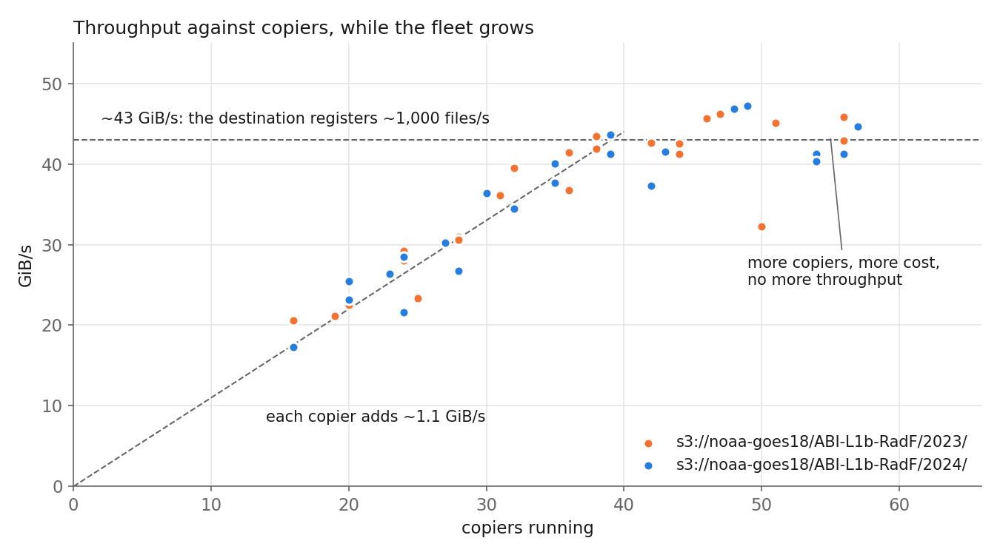
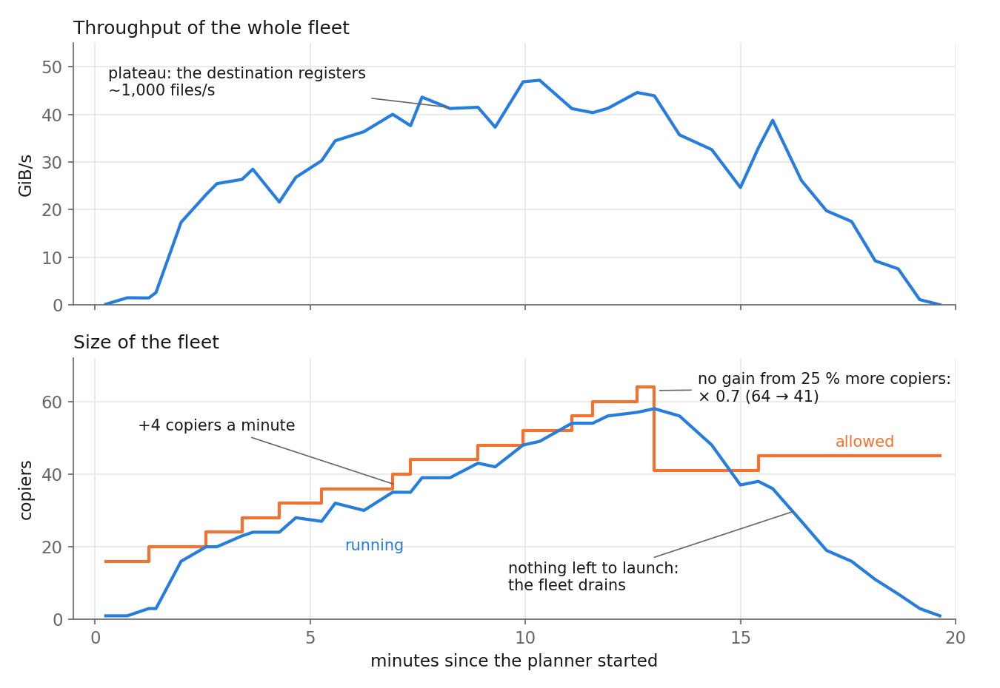

# Adaptive concurrency

A copy runs many copier Jobs at the same time. This page explains how hf-s3ream decides how many, and how fast each one sends. The other choices (the plan, the check at the end) are in [DESIGN.md](DESIGN.md).

- [In short](#in-short)
- [The fleet size](#the-fleet-size)
- [On a real copy](#on-a-real-copy)
- [Why this rule](#why-this-rule)
- [The copier brake](#the-copier-brake)
- [Settings and logs](#settings-and-logs)
- [Testing](#testing)

## In short

Two loops share the work:

- **The fleet size**, in the planner, every 2 minutes: how many copiers run at once. It grows while more copiers bring more throughput, and shrinks when they bring only cost or latency.
- **The copier brake**, in each copier, within seconds: how many bytes per second the copier sends. It sends at full speed, and slows down only when the storage answers "slow down" (429, 5xx).

Both serve two of the [goals](DESIGN.md#goals): throughput at a known cost, and no harm to CAS, the storage behind HF Buckets, shared by every Hub user. The copiers need no coordination: they all see the same CAS, so they react together.

## The fleet size

At first, each new copier adds about the same throughput. Past some point, a new copier adds nothing: it costs a Job, and the copy does not end sooner. What the storage can take also changes during a copy: other users, new capacity. So the planner measures its fleet again and again, and moves its size up or down.



*Two copies of public NOAA data (files of ~40–50 MiB), while their fleet grew. Up to ~40 copiers, each copier adds ~1.1 GiB/s. Past ~45, the throughput stays near 43 GiB/s: the destination registers ~1,000 files per second, and more copiers do not change that. Data: the planner's `PLAN_PROGRESS` lines ([`images/data/`](images/data/)).*

### The rule

The rule is AIMD, as in TCP: add slowly, cut by a factor. What it watches is the **power** `P = throughput / latency` (Kleinrock's power). `P` grows while copiers add throughput faster than they add latency. It is highest where CAS starts to queue.

```text
target = 16                        # copiers allowed at once, within the plan's limit

every minute, but not during the measure after a cut:
    if the fleet filled its target at some point of that minute:
        target = target + 4

while ranges are left to launch, measure 2 minutes, then again:
    N    = the copiers launched during the measure, on average
    P    = throughput / latency
    best = the measure with the most power in the last 10 minutes
    if the previous measure cut the fleet:          decide nothing   # it is still shrinking
    elif P is lower than best, at the same size:    target = 0.7 × N, forget the old measures
    elif P is lower than best, with more copiers:   target = 0.7 × N
    elif P is not higher, with 25 % more copiers:   target = 0.7 × N
```

The words of this rule:

- **The fleet `N`** counts the copiers launched: running, or waiting for a machine. A fleet that cannot fill its target (a slow listing, few ranges left) does not grow it further.
- **The throughput** is the bytes the copiers send per second.
- **The latency** is the geometric mean of two calls answered by CAS: the upload grant and the xorb commit. Each copier gives the 90th percentile of each call, and the planner takes the median over the copiers. Not the shard: copiers send one when a session ends, often together, and its time follows that more than CAS. Not the PUT: it goes to the storage, not to CAS.
- **Lower, higher** mean by more than 2σ. The 2 minutes are cut in 4 slices. The noise `σ` is their spread around their trend, pooled over the last 10 minutes.
- **The best** measure: of those with the most power, the one with the fewest copiers. The same power with fewer copiers costs less.
- **The first measure** starts 30 s after the first 16 copiers run. There is no measure once no range is left to launch: the fleet then drains, and there is nothing left to decide.

What it does in each case:

| What happens | What the fleet does |
|---|---|
| The latency stays flat and the throughput grows | It keeps growing. |
| CAS adds capacity | The power grows: it keeps growing. |
| The latency grows faster than the throughput | It shrinks. |
| Copiers add nothing (a slow source, the destination's file registrations) | It saw-tooths between its best size and 25 % past it. |
| CAS gets slower at the same size (other users) | It shrinks, and starts again from new measures. |

## On a real copy



*A copy of `s3://noaa-goes18/ABI-L1b-RadF/2024/` (838,802 files, 32.9 TiB, verified). The fleet grows by 4 copiers a minute. The throughput stops growing near 43 GiB/s, while the fleet keeps growing to 64. The next measure sees no clear gain with 25 % more copiers than the best size, and cuts the fleet to 41. Then no range is left to launch, and the fleet drains. At the end, one range ran again. The throughput is a 5-second sample every ~30 s, so it is noisy. Data: the planner's `PLAN_PROGRESS` lines ([`images/data/goes18-2024.csv`](images/data/goes18-2024.csv)).*

## Why this rule

- **Steps, not doublings.** Adding copiers at a steady pace leaves CAS time to scale. Doubling from 32 to 64 copiers added ~35 GiB/s in a minute, and CAS answered with a wave of 500s. Doubling from 8 was also slow at the start: the fleet now starts at 16.
- **A gentle cut.** × 0.7 is CUBIC's β, gentler than Reno's ½. On a plateau, the cut comes at 25 % past the best size, so it lands near the best size (0.7 × 1.25 ≈ 0.9 of it). No copier is stopped: the fleet only shrinks as its ranges end.
- **One cut per event.** A fleet shrinks as its ranges end, so the measure after a cut sees it shrinking, not its new size. That measure decides nothing, and the fleet does not grow during it. TCP, too, cuts once per congestion event. (Without this, a real copy was cut twice in a row, 64 → 41 → 36.)
- **Few rules.** An earlier version climbed with Rprop's steps, probed every 10 minutes and shrank on any tie. Its rules piled up, and the fleet swung from 4 to 41 copiers in the tests.
- **A best that ages.** Each measure leaves the 10-minute window on its own, so the best ages smoothly. When a single best expired at once, the next measure took its place, even one taken past the knee, and the fleet lost its bearings.
- **Pooled noise.** 4 slices tell their noise badly. One agitated measure (copiers ending and starting together) gave σ = 14 % on a real copy, which hid a real loss of 25 % of the power.
- **Errors stay with the copiers.** The planner does not watch them. When copiers brake, the fleet throughput drops, so the power drops, and the next measure gives copiers back. The reaction is in proportion: one 500 on one copier of 60 is noise; an overload that brakes many copiers is a clear loss.

## The copier brake

The fleet size sets how hard the fleet pushes in all. The brake in each copier reacts within seconds, between two measures of the fleet.

**An adaptive rate** (`--brake`, default `on`). A token bucket sets how many bytes per second the copier feeds to xet. The copier listens to xet's own events (through a tracing layer, whatever `RUST_LOG` shows) for **errors that say "slow down"** from CAS: 429, 5xx, timeouts, dropped connections. One alone is common; three in 10 s count. Other errors (403, 404, …) do not brake.

The rate follows TCP's slow start, then CUBIC's gentle cut:

| What the copier sees | What it does |
|---|---|
| no error yet | starts at 64 MiB/s and doubles the rate every 2 s while it uses it: full speed in ~10 s, no ceiling |
| a congestion error | cuts the rate it really used to 70 %, then holds 10 s |
| after the hold | doubles back up to 90 % of that rate, then adds 1/32 of it every 2 s |

- At most one cut every 15 s. The holds are spread by ±20 %, so the copiers do not all climb back at once. (Halving and holding 30 s took a fleet of 64 from ~70 to ~5 GiB/s, every copier at once, and it came back slowly.)
- The rate never goes below 16 MiB/s.
- A copier that does not use its rate (a slow source, or its own full speed) does not raise it.
- No ceiling: an earlier fleet budget, a safe level split between the copiers, capped each copier at a share of it, and the fleet stuck near 20 GiB/s however many copiers ran.

**It times each upload call**: the upload grant, the xorb commit and the shard (answered by CAS), and the PUT of each xorb to the storage (timed to tell where a slow upload comes from). Each `PROGRESS` line carries the 90th percentile of each over the last seconds (`brake.latency`, in ms, or ms per MiB for the xorbs and shards). When CAS queues, the slow tail grows first, while the median stays flat. One copier lives a few minutes: too short to tell a trend from noise. So the planner reads these times across the fleet ([The fleet size](#the-fleet-size)).

The xet client also keeps at most 64 xorb uploads in flight per copier (its high-performance mode allows 124). `HF_XET_CLIENT_AC_MAX_UPLOAD_CONCURRENCY` still sets another value.

## Settings and logs

- `--max-inflight` (or *Advanced* in the Space) sets the plan's limit: the fleet size stays within it. The plan proposes up to 64.
- The planner reads the copiers' logs to measure the fleet. With `--no-live-progress` it does not, and it starts up to `--max-inflight` copiers at once.
- `--brake shadow` computes and logs the copier's rate without applying it; `--brake off` turns the brake off.
- In the planner's log, `PLAN_PROGRESS` carries the fleet latency (`latency`) and the size allowed (`target`). Each measure is logged as a `growth: measure` line: the size before and after, the change of power, `σ`, and why.
- In a copier's log, each `PROGRESS` line carries the brake's state (`brake`: rate, last action, cuts, errors seen, latency), and each cut is logged.

## Testing

`bench/brake_bench.py` runs real copiers against a local fake of S3, the Hub API and CAS, with a simple model of CAS under load (cores, a queue, 429 and 503, an autoscaler). Nothing leaves the machine. The rule of the fleet size has its own tests in `src/growth.rs`, on simulated fleets: a CAS that scales, one that queues, a plateau, a CAS that adds capacity, braking copiers.
