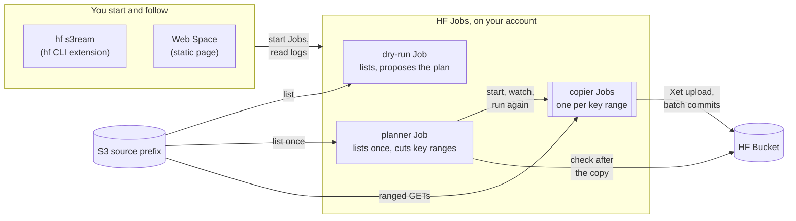
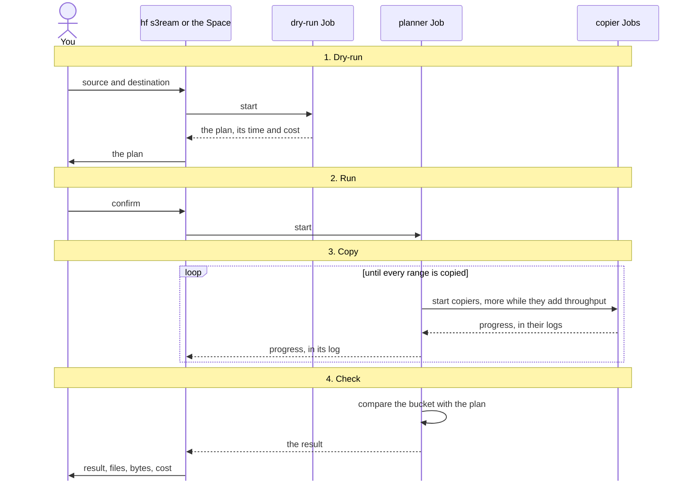
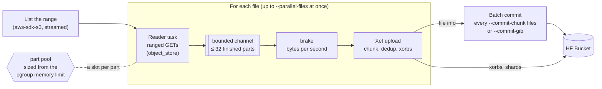

# Architecture

This page describes how hf-s3ream is built: the Jobs of a copy, the path of the bytes, what runs inside a copier, and where each part lives in the code. Why it is built this way is in [DESIGN.md](DESIGN.md). How to use it is in [GUIDE.md](GUIDE.md).

## Bird's eye view

A copy is a set of [HF Jobs](https://huggingface.co/docs/hub/jobs) that run one container image, `ghcr.io/glutamatt/hf-s3ream`. The same binary plays three roles, chosen by its flags:

- the **dry-run** (`--dry-run`) lists the source and proposes a plan;
- the **planner** (`--plan`) lists the source once, cuts it into key ranges, and starts one copier Job per range;
- the **copier** (`--start-after K --stop-at K`) copies one key range from S3 to the bucket.

The `hf s3ream` CLI and the web Space are two clients of these Jobs. They start them through the Hugging Face API, and read their logs. Neither of them touches the data.

Each copier is its own path from S3 to the bucket. The planner never touches the data: it only lists keys, starts Jobs, reads their logs and checks the result. No byte is written to a local disk on the way.

## The life of a copy

Who talks to whom, from the first command to the result. The Jobs read S3 and write the bucket as in the [bird's eye view](#birds-eye-view).

1. **Dry-run.** The client starts a small dry-run Job. A missing destination bucket is created private: by the CLI once the copy is confirmed, by the Space at this step (its **Analyze** button). The Job lists the source from Hugging Face's side, so it also checks that the Jobs can read it, and it detects the bucket's region. It prints the plan as one `DRYRUN_PLAN {…}` line: the CLI and the Space read that line, so they always propose the same plan. A very large source is listed for 2 minutes only: the plan is then sized from the part listed, and the planner lists the whole source itself.
2. **Run.** The client starts one planner Job. The planner is autonomous: the copy does not need the terminal or the browser tab that started it.
3. **Copy.** The planner lists the prefix once and cuts it into contiguous key ranges, balanced by bytes. It starts one copier Job per range, a few at first, then more each minute while the destination keeps up, within the plan's limit (see [Adaptive concurrency](ADAPTIVE-CONCURRENCY.md)). It follows the log of each copier, and starts a failed range again, up to 3 times. Running a range again is safe: Xet only uploads the chunks the storage does not have yet.
4. **Check.** Once every range is done, the planner reads the destination back and compares it with the plan (see [Verification](DESIGN.md#verification)).

### What each client reads

Every Job prints marker lines, `NAME {json}`, in its log. The clients read them through the Jobs log stream of the Hugging Face API:

| Line | Printed by | Read by |
|---|---|---|
| `DRYRUN_PLAN` | dry-run | CLI, Space: the plan and its cost |
| `LISTING`, `PROGRESS`, `DONE`, `SIZING` | copier | planner (the fleet), Space (the live graph) |
| `PLAN_PROGRESS` | planner | CLI (the live progress); fields: stages, bytes, files, `hf_mibps_5s`, `latency`, `target`, … |
| `growth:` | planner | people: each change of the fleet size, and why |
| `VERIFY`, `PLAN_RESULT` | planner | CLI, Space: the result of the check (`verified: true\|false\|null`) |

During the copy, the CLI and the Space also read the cost of each Job from your billing.

### Labels, stop and secrets

- Every Job of a copy has the label `hf-s3ream-run=<run label>`. `hf s3ream status`, `attach` and `stop` find a copy by this label, or by the planner Job id, from any terminal. This also works for a copy started in the Space.
- **A copier never outlives its planner.** Cancelling the planner Job stops the whole copy: HF Jobs sends the planner SIGTERM, and the planner cancels its copiers before it ends. A copier whose planner has ended cancels itself (after a minute, or a few minutes for a big fleet). A planner that reaches its timeout stops the copy the same way.
- **Secrets.** The client sends the AWS keys and the Hugging Face token as encrypted Job secrets, through the Hugging Face API: from your machine with the CLI, from your browser with the Space. The planner passes them to each copier, also as encrypted secrets. They never reach a server that hf-s3ream runs: there is none.
- **The Space is a static page.** It has no backend. The browser signs you in (OAuth) and calls the Hugging Face API directly (CORS).

## Inside a copier

Listing, reading, uploading and committing overlap: uploads start with the first object, and commits run in the background.

- **Listing**: `aws-sdk-s3` (it accepts exotic keys that `object_store::list` rejects, for example empty path segments), streamed: memory stays bounded.
- **Reads**: `object_store` ranged GETs (`--s3-part-concurrency` parallel reads per file), decoupled from the Xet compute by a spawned reader and a bounded channel, so S3 reads never stall behind hashing. A file must deliver exactly the expected number of bytes, or it fails.
- **Uploads**: xet-core's `FileUploadSession`, shared by all files of a commit chunk: xorbs and shards are deduplicated within the chunk. When the Hub offers it, each xorb goes straight to the storage S3 bucket through a short-lived upload URL (xet-core 1.8.0 "direct-to-S3" uploads). If that URL cannot be reached, xet-core falls back to the classic upload; `HF_XET_CLIENT_LEGACY_DIRECT_XORB_UPLOAD=1` forces the classic upload.
- **Commit**: one batched ndjson POST to the bucket's batch API per `--commit-chunk` files (or `--commit-gib`), pipelined. Sessions rotate as files stream in and finalize in the background, so commits never pause the transfer. The copier reads the `failed[]` list of each answer, and sends those files again.
- **Brake**: a token bucket sets how many bytes per second the copier feeds to Xet (see [the copier brake](ADAPTIVE-CONCURRENCY.md#the-copier-brake)).

### Memory

No byte touches a local disk in the hot path. A file read in parts holds, at most: `--s3-part-concurrency` parts being read, up to 32 finished parts waiting for the upload pipeline, 2 parts in hand (one waiting to be queued, one being chunked), and the xorb formation window (~64–128 MiB). A file read with a single GET holds only the xorb window.

The parts of all files come from one **part pool**. A part takes a slot before its GET starts, and gives it back once the upload pipeline has used it. So a file copied alone reads with `--s3-part-concurrency` GETs, and files copied at the same time share the pool. A file takes no new slot while it holds its fair share: the pool size divided by the files reading in parts at that moment. This keeps a file whose upload is slower than its reads from holding slots the other files could use.

At startup the copier reads the memory limit of its cgroup: it follows `/proc/self/cgroup` and takes the lowest limit up to the root (cgroup v2 `memory.max`, or v1 `memory.limit_in_bytes`). No limit found means a pool large enough for every file at full part concurrency. With a limit, the parts and the xorb windows may use 60% of it, or less when the fixed part needs more: 1 GiB, plus 64 MiB for each xorb upload the xet client may run at once. Each file in flight reserves its xorb window (128 MiB), and the pool gets the rest, but at least enough for one file at full part concurrency. When that does not fit, `--parallel-files` is lowered. `--s3-part-concurrency` is never changed. The copier logs the result and prints it as a `SIZING {…}` line; each `PROGRESS` line carries the slots in use and the resident memory.

Example: a Jobs flavor sold as 32 GB has a limit of 32,000,000,000 bytes (29.8 GiB). There, the planner's big-file settings (32 files × 128 parts) get a pool of 888 parts, and its small-file settings (128 files × 8 parts) a pool of 120.

## Code map

| Path | What it holds |
|---|---|
| `src/main.rs` | The flags, and the choice of role: dry-run, planner, copier, single process. |
| `src/reco.rs` | The plan from the dry-run: flavor, range size, fleet limit, timeout, cost (`DRYRUN_PLAN`). |
| `src/sync.rs` | The copy itself: listing, reads, uploads, commits; and the planner: ranges, copier Jobs, attempts. |
| `src/cas_uploader.rs` | The Xet upload pipeline for buckets (xet-core). |
| `src/bucket_client.rs` | The bucket batch API: commits and their `failed[]` list. |
| `src/jobs_client.rs` | The HF Jobs API: start, list, watch and cancel Jobs. |
| `src/fleet.rs` | The planner's live view of its copiers, from their logs, printed as `PLAN_PROGRESS`. |
| `src/growth.rs` | The fleet size: AIMD on the power `throughput / latency`. |
| `src/brake.rs` | The copier brake: adaptive rate toward the storage, and the latency of each upload call. |
| `src/memory.rs` | The part pool, sized from the cgroup memory limit. |
| `src/progress.rs` | Transfer metrics (S3 read and upload counters) and the stall watchdog. |
| `src/verify.rs` | The destination check after a copy. |
| `src/stop.rs` | How a copy stops: a copier never outlives its planner. |
| `cli/` | The `hf s3ream` extension (Python): plan, confirm, follow, `status` / `attach` / `stop`, `--local`. See [`cli/README.md`](../cli/README.md). |
| `space/` | The web Space: one static page (`index.html`, `app.js`, `style.css`). |
| `bench/brake_bench.py` | A local bench for the brakes: real copiers against a fake S3, Hub API and storage. |
| `docs/images/` | The charts of these pages, and the script that draws them. |
