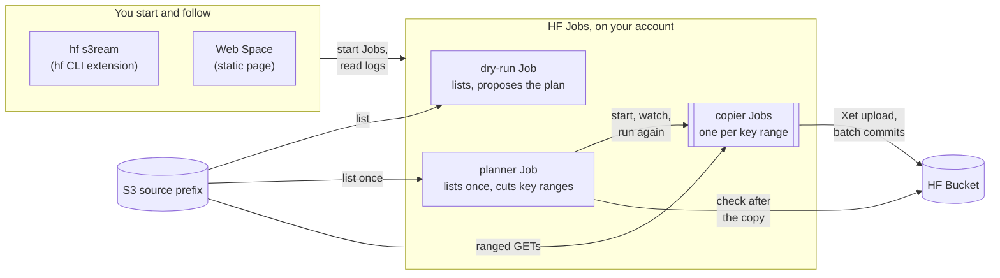
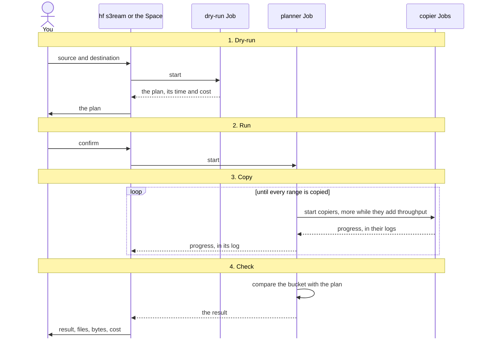
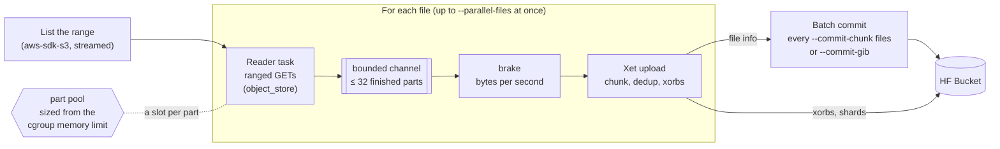

# Architecture

This page describes how hf-s3ream is built: the Jobs of a copy, the path of the bytes, what runs inside a copier, and where each part is in the code. Why it is built this way is in [DESIGN.md](DESIGN.md). How to use it is in [GUIDE.md](GUIDE.md).

## Bird's eye view

A copy is a set of [HF Jobs](https://huggingface.co/docs/hub/jobs) that run one container image, `ghcr.io/glutamatt/hf-s3ream`. The same binary has three roles. Its flags choose the role:

- the **dry-run** (`--dry-run`) lists the source and proposes a plan;
- the **planner** (`--plan`) lists the source once, cuts it into key ranges, and starts one copier Job for each range;
- the **copier** (`--start-after K --stop-at K`) copies one key range from S3 to the bucket.

The `hf s3ream` CLI and the web Space are two clients of these Jobs. They start the Jobs through the Hugging Face API, and read their logs. They never touch the data.

Each copier is its own path from S3 to the bucket. The planner never touches the data: it only lists keys, starts Jobs, reads their logs and checks the result. No byte is written to a local disk on the way.

## The life of a copy

Who talks to whom, from the first command to the result. The Jobs read S3 and write the bucket as in the [bird's eye view](#birds-eye-view).

1. **Dry-run.** The client starts a small dry-run Job. A missing destination bucket is created as a private bucket: by the CLI after you confirm the copy, and by the Space at this step (its **Analyze** button). The Job lists the source from the Hugging Face side, so it also checks that the Jobs can read the source. It finds the region of the bucket. It prints the plan as one `DRYRUN_PLAN {…}` line. The CLI and the Space read this line, so they always propose the same plan. A very large source is listed for 2 minutes only. The plan is then made from the part listed, and the planner lists the whole source itself.
2. **Run.** The client starts one planner Job. The planner works alone: the copy does not need the terminal or the browser tab that started it.
3. **Copy.** The planner lists the prefix once. It cuts the list into contiguous key ranges, with about the same number of bytes in each. It starts one copier Job for each range: a few at first, then more each minute while the destination is fast enough, within the limit of the plan (see [Adaptive concurrency](ADAPTIVE-CONCURRENCY.md)). It follows the log of each copier. When a range fails, it starts it again, up to 3 times. It is safe to run a range again: Xet only uploads the chunks that the storage does not have yet.
4. **Check.** When all the ranges are done, the planner reads the destination and compares it with the plan (see [Verification](DESIGN.md#verification)).

### What each client reads

Each Job prints marker lines, `NAME {json}`, in its log. The clients read them through the log stream of the Jobs, in the Hugging Face API:

| Line | Printed by | Read by |
|---|---|---|
| `DRYRUN_PLAN` | dry-run | CLI, Space: the plan and its cost |
| `LISTING`, `PROGRESS`, `DONE`, `SIZING` | copier | planner (the fleet), Space (the live graph) |
| `PLAN_PROGRESS` | planner | CLI (the live progress); fields: stages, bytes, files, `hf_mibps_5s`, `latency`, `target`, … |
| `growth:` | planner | people: each change of the fleet size, and why |
| `VERIFY`, `PLAN_RESULT` | planner | CLI, Space: the result of the check (`verified: true\|false\|null`) |

During the copy, the CLI and the Space also read the cost of each Job from your billing.

### Labels, stop and secrets

- Each Job of a copy has the label `hf-s3ream-run=<run label>`. `hf s3ream status`, `attach` and `stop` find a copy by this label, or by the id of the planner Job, from any terminal. This also works for a copy started in the Space.
- **A copier never runs longer than its planner.** To stop the whole copy, cancel the planner Job: HF Jobs sends SIGTERM to the planner, and the planner cancels its copiers before it ends. A copier whose planner has ended cancels itself (after one minute, or a few minutes for a big fleet). When the planner reaches its time limit, it stops the copy in the same way.
- **Secrets.** The client sends the AWS keys and the Hugging Face token as encrypted Job secrets, through the Hugging Face API: from your machine with the CLI, and from your browser with the Space. The planner gives them to each copier, also as encrypted secrets. They never reach a server that hf-s3ream runs: there is none.
- **The Space is a static page.** It has no backend. The browser signs you in (OAuth) and calls the Hugging Face API directly (CORS).

## Inside a copier

The listing, the reads, the uploads and the commits run at the same time: the uploads start with the first object, and the commits run in the background.

- **Listing**: `aws-sdk-s3`. It accepts unusual keys that `object_store::list` refuses, for example keys with an empty path segment. The listing is streamed, so the memory stays bounded.
- **Reads**: `object_store` ranged GETs (`--s3-part-concurrency` parallel reads per file). A separate reader task and a bounded channel keep the reads apart from the Xet compute, so the S3 reads never wait for the hashing. A file must give exactly the expected number of bytes, or it fails.
- **Uploads**: the `FileUploadSession` of xet-core, shared by all the files of a commit chunk: xorbs and shards are deduplicated within the chunk. When the Hub offers it, each xorb goes directly to the S3 bucket of the storage, through an upload URL that is valid for a short time (the "direct-to-S3" uploads of xet-core 1.8.0). If xet-core cannot reach this URL, it uses the classic upload. `HF_XET_CLIENT_LEGACY_DIRECT_XORB_UPLOAD=1` forces the classic upload.
- **Commit**: one batched ndjson POST to the batch API of the bucket for each `--commit-chunk` files (or `--commit-gib`), in a pipeline. A new session starts while the files come in, and the old one ends in the background, so the commits never pause the transfer. The copier reads the `failed[]` list of each answer, and sends these files again.
- **Brake**: a token bucket sets how many bytes per second the copier gives to Xet (see [the copier brake](ADAPTIVE-CONCURRENCY.md#the-copier-brake)).

### Memory

No byte goes to a local disk during the copy. A file read in parts holds, at most: `--s3-part-concurrency` parts being read, up to 32 finished parts that wait for the upload pipeline, 2 parts in hand (one that waits for the queue, one being chunked), and the xorb formation window (~64–128 MiB). A file read with a single GET holds only the xorb window.

The parts of all the files come from one **part pool**. A part takes a slot before its GET starts, and gives it back when the upload pipeline has used it. So a file copied alone reads with `--s3-part-concurrency` GETs, and files copied at the same time share the pool. A file takes no new slot while it holds its fair share: the pool size divided by the number of files that read in parts at that moment. So a file whose upload is slower than its reads cannot keep slots that the other files could use.

At its start, the copier reads the memory limit of its cgroup. It follows `/proc/self/cgroup` and takes the lowest limit up to the root (cgroup v2 `memory.max`, or v1 `memory.limit_in_bytes`). If it finds no limit, the pool is large enough for all the files at full part concurrency. With a limit, the parts and the xorb windows may use 60% of it. They get less when the fixed part needs more: 1 GiB, plus 64 MiB for each xorb upload that the xet client may run at once. Each file in flight reserves its xorb window (128 MiB), and the pool gets the rest, but at least enough for one file at full part concurrency. When this does not fit, `--parallel-files` is lowered. `--s3-part-concurrency` never changes. The copier logs the result and prints it as a `SIZING {…}` line. Each `PROGRESS` line gives the slots in use and the resident memory.

Example: a Jobs flavor sold as 32 GB has a limit of 32,000,000,000 bytes (29.8 GiB). There, the settings of the planner for big files (32 files × 128 parts) get a pool of 888 parts, and its settings for small files (128 files × 8 parts) get a pool of 120.

## Code map

| Path | What it holds |
|---|---|
| `src/main.rs` | The flags, and the choice of role: dry-run, planner, copier, single process. |
| `src/reco.rs` | The plan from the dry-run: flavor, range size, fleet limit, timeout, cost (`DRYRUN_PLAN`). |
| `src/sync.rs` | The copy itself: listing, reads, uploads, commits; and the planner: ranges, copier Jobs, attempts. |
| `src/cas_uploader.rs` | The Xet upload pipeline for buckets (xet-core). |
| `src/bucket_client.rs` | The bucket batch API: commits and their `failed[]` list. |
| `src/jobs_client.rs` | The HF Jobs API: start, list, watch and cancel Jobs. |
| `src/fleet.rs` | The planner's live view of its copiers, from their logs, printed as `PLAN_PROGRESS`. |
| `src/growth.rs` | The fleet size: AIMD on the power `throughput / latency`. |
| `src/brake.rs` | The copier brake: adaptive rate toward the storage, and the latency of each upload call. |
| `src/memory.rs` | The part pool, sized from the cgroup memory limit. |
| `src/progress.rs` | Transfer metrics (S3 read and upload counters) and the stall watchdog. |
| `src/verify.rs` | The destination check after a copy. |
| `src/stop.rs` | How a copy stops: a copier never runs longer than its planner. |
| `cli/` | The `hf s3ream` extension (Python): plan, confirm, follow, `status` / `attach` / `stop`, `--local`. See [`cli/README.md`](../cli/README.md). |
| `space/` | The web Space: one static page (`index.html`, `app.js`, `style.css`). |
| `bench/brake_bench.py` | A local bench for the brakes: real copiers against a fake S3, Hub API and storage. |
| `docs/images/` | The charts of these pages, and the script that draws them. |
