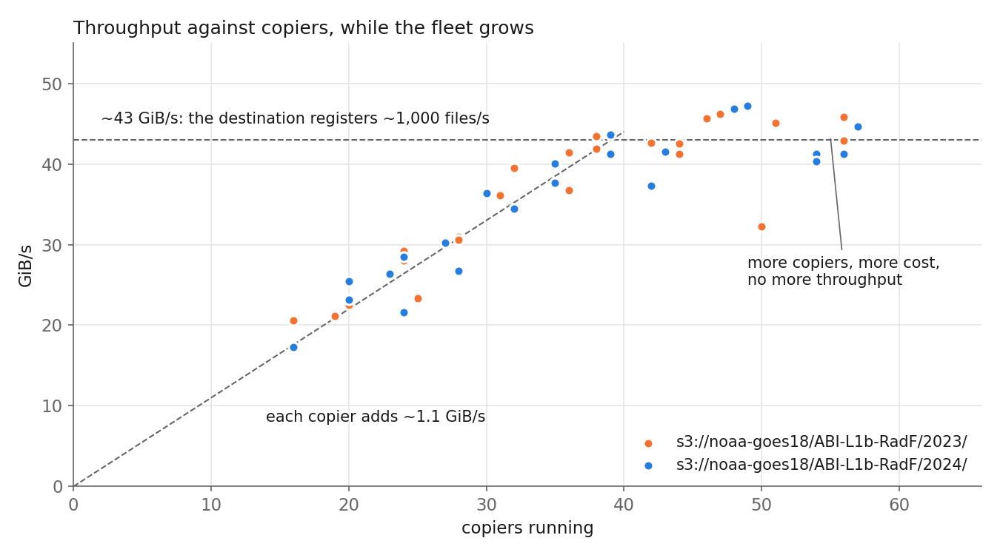
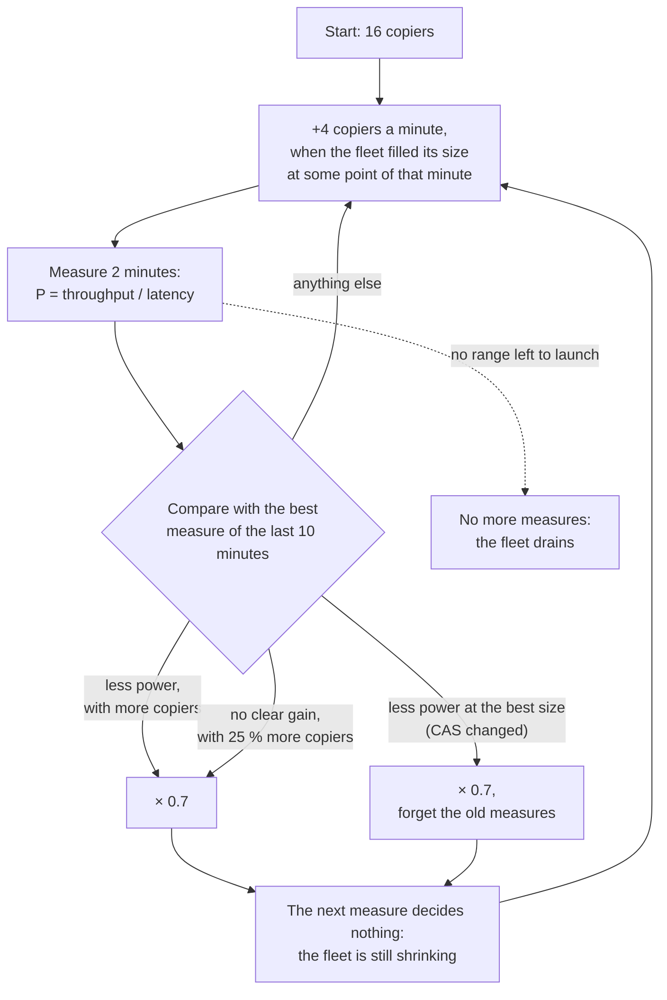
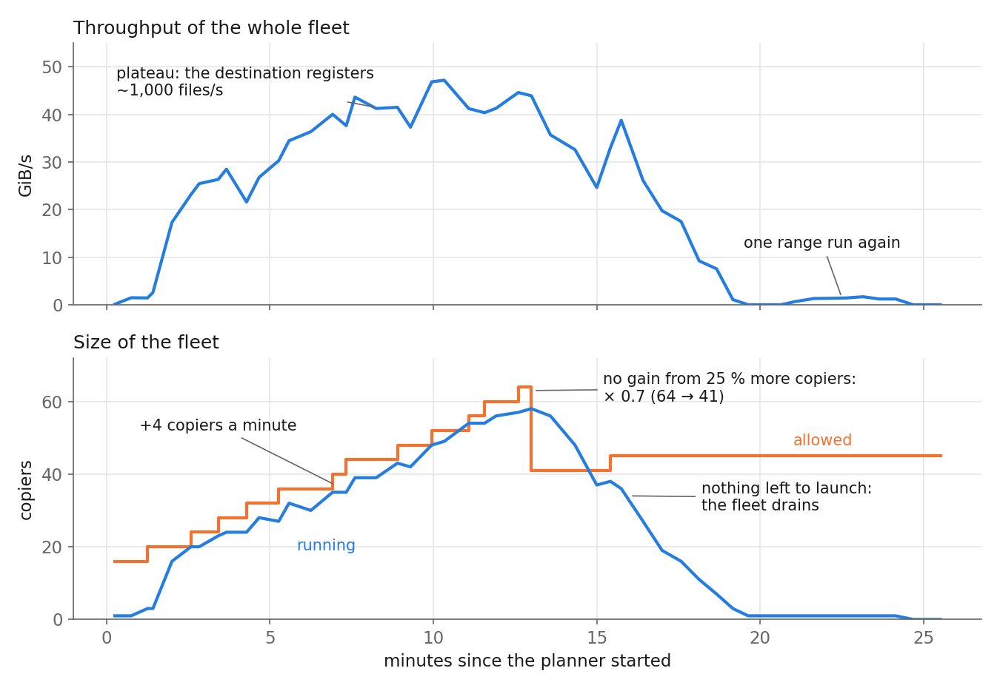
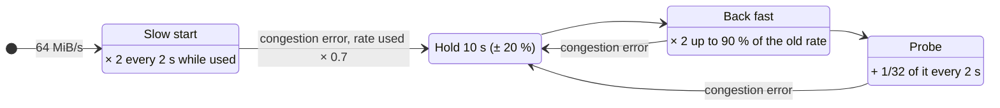

# Design

This page explains the choices behind hf-s3ream, and why they were made: the plan, the size of the copier fleet, the brake in each copier, and the check at the end. How the pieces fit together is in [ARCHITECTURE.md](ARCHITECTURE.md).

- [Goals](#goals)
- [Many copiers, one listing](#many-copiers-one-listing)
- [The plan](#the-plan)
- [The fleet size](#the-fleet-size)
- [The copier brake](#the-copier-brake)
- [Verification](#verification)
- [Testing the brakes](#testing-the-brakes)

## Goals

1. **Throughput at a known cost.** A copy should be as fast as the destination allows, and a copier that adds no throughput should not run: it only costs.
2. **No harm to the shared storage.** CAS, the storage behind HF Buckets, is shared by every Hub user. A copy must not push it past what it can take.
3. **A copy you can trust.** Every copy ends with a check of the destination against the plan.

## Many copiers, one listing

One machine is limited by its network card, however well it is tuned. hf-s3ream does not use one machine: each copier is a Job with its own path from S3 to the bucket, so more copiers copy more at the same time, until another limit takes over.

- **One listing.** The planner lists the prefix once and cuts it into contiguous key ranges, balanced by bytes. The cut does not depend on the layout of the keys. (The first version split the files by a hash of their name, in a Slurm array.)
- **Ranges of different sizes.** Each range takes ½ to 1½ of the range size, so copiers started together do not all end together.
- **Idempotent copiers.** A copier that fails is started again on the same range. Xet only uploads the chunks the storage does not have yet, so a second attempt costs little.
- **In memory.** A copier streams S3 into the Xet upload, with no local disk. Reads and uploads run at the same time (see [Inside a copier](ARCHITECTURE.md#inside-a-copier)).

## The plan

The dry-run proposes the plan from the size and the file count it listed. `hf s3ream` and the Space get the same plan: it comes from the binary (`src/reco.rs`).

- **Most copies are bound by bandwidth.** Each copier is an independent S3 → CAS path, so the throughput grows with the number of copiers. The plan uses `cpu-performance` copiers: on the smaller flavors, the speed changed a lot from one Job to the next. The ranges are ~64 GiB up to 1 TiB, so up to 16 copiers; 16 copiers between 1 and 3 TiB; ~192 GiB past 3 TiB (a few minutes per copier: with shorter ranges, copiers ended every minute, and each new one waited for a machine and paid a started minute). The plan aims at 256 ranges at most, so past ~48 TiB the ranges grow. At most 64 copiers run at once, and the planner sets how many within that limit (see [The fleet size](#the-fleet-size)).
- **Many small files are bound by the commits.** The destination registers about 1,000 files per second per repo. When the files average 4 MiB or less and the registrations take longer than the bytes, more copiers would not finish sooner: the plan uses the smallest fleet that keeps up (2 or more copiers), on a cheaper flavor when that is enough.
- **A copy under 5 GiB** takes one small copier: a copier's startup takes longer than the transfer.

A range ends at its size or at 2 million keys, whichever comes first. You can change the plan by hand (with `--copier-flavor`, `--range-gib` and `--max-inflight`, or under *Advanced* in the Space): there is no cost estimate then.

## The fleet size

The planner decides how many copiers run at once. Three ideas set it:

- **Each copier sends at full speed.** A copier has no fixed share of a budget. Its own brake only slows it down when the storage says "slow down" (see [The copier brake](#the-copier-brake)).
- **More copiers only while they pay.** At first, each new copier adds about the same throughput. Past some point, a new copier adds nothing: it costs a Job, and the copy does not end sooner. The planner stops there.
- **The fleet follows the destination, live.** What the storage can take changes during a copy: other users, new capacity. The planner measures again and again, and grows or shrinks the fleet.

*Two copies of public NOAA data (files of ~40–50 MiB), while their fleet grew. Up to ~40 copiers, each copier adds ~1.1 GiB/s. Past ~45, the throughput stays near 43 GiB/s: the destination registers ~1,000 files per second, and more copiers do not change that. Data: the planner's `PLAN_PROGRESS` lines ([`images/data/`](images/data/)).*

### The rule

The size follows AIMD, as TCP, on the power `P = throughput / latency` (Kleinrock's power). `P` grows while copiers add throughput faster than they add latency, and is highest where CAS starts to queue.

- **Growth.** The fleet starts at 16 copiers and gains **4 copiers a minute** (~4 GiB/s more per minute), when it filled its target at some point of that minute. `N` counts the copiers launched (running, or waiting for a machine): a fleet that cannot fill its target (a slow listing, the commit budget) does not grow it further.
- **The measure.** The planner measures over 2 minutes, the first time once the first 16 copiers run, then one measure after the other, until no range is left to launch: the throughput, and `L`, the geometric mean of the latencies of the grant and the xorb commit (each the 90th percentile of a copier, then the median over the copiers). Not the shard: copiers send one when a session ends, often together, and its time follows that more than CAS. Not the PUT: it goes to the storage, not to CAS. The 2 minutes are cut in 4 slices: their spread around their trend, pooled over the last 10 minutes, gives the noise `σ`.
- **The decision.** Each measure is compared with the best one of the last 10 minutes (of those with the most power, the one with the fewest copiers):

  | What the measure shows | What the fleet does |
  |---|---|
  | less power than the best (by more than 2σ), with more copiers | × 0.7 |
  | less power at the best size (CAS changed) | × 0.7, and the old measures are forgotten |
  | no clear gain with 25 % more copiers than the best | × 0.7 |
  | anything else (fewer copiers than the best included) | +4 copiers a minute |

- **One cut per event.** A fleet shrinks as its ranges end, so the measure after a × 0.7 sees it shrinking, not its new size: that measure decides nothing (TCP, too, cuts once per congestion event).

What it does in each case:

- Latency stable and throughput up: the fleet keeps growing.
- CAS adds capacity: more power, it keeps growing.
- Latency up faster than throughput: it shrinks.
- Copiers that add nothing (a slow source, or the destination's file registrations): it saw-tooths from its best size to 25 % past it.

### On a real copy

*A copy of `s3://noaa-goes18/ABI-L1b-RadF/2024/` (838,802 files, 32.9 TiB, verified). The fleet grows by 4 copiers a minute. The throughput stops growing near 43 GiB/s, while the fleet keeps growing to 64. The next measure sees no clear gain with 25 % more copiers than the best size, and cuts the fleet to 41. Then no range is left to launch, and the fleet drains. At the end, one range ran again. The throughput is a 5-second sample every ~30 s, so it is noisy. Data: the planner's `PLAN_PROGRESS` lines ([`images/data/goes18-2024.csv`](images/data/goes18-2024.csv)).*

### Why this rule

- **Steps, not doublings.** Adding copiers at a steady pace leaves CAS time to scale: doubling from 32 to 64 copiers added ~35 GiB/s in a minute, and CAS answered with a wave of 500s. Doubling from 8 was also slow at the start: the fleet now starts at 16.
- **A gentle cut.** × 0.7 is CUBIC's β, gentler than Reno's ½.
- **Few rules.** An earlier version climbed with Rprop's steps, probed every 10 minutes and shrank on any tie: its rules piled up, and the fleet swung from 4 to 41 copiers in the tests.
- **A best that ages.** Each measure leaves the 10-minute window on its own, so the best ages smoothly. When a single best expired at once, the next measure took its place, even one taken past the knee, and the fleet lost its bearings.
- **Pooled noise.** 4 slices tell their noise badly: one agitated measure (copiers ending and starting together) gave σ = 14 % on a real run, which hid a real loss of 25 % of the power.
- **Errors stay with the copiers.** The planner does not watch them: when copiers brake, the fleet throughput drops, so the power drops, and the next measure gives copiers back. The reaction is in proportion: one 500 on one copier of 60 is noise; an overload that brakes many copiers is a clear loss.

The planner reads the copiers' logs to do this: with `--no-live-progress` it is off, and the planner starts up to `--max-inflight` copiers at once. `PLAN_PROGRESS` carries the fleet latency (`latency`) and the size allowed (`target`); each change of size is logged (`growth:`).

## The copier brake

CAS is shared by every Hub user, and a fleet of copiers can push faster than it can grow. Two brakes keep a copy fast without overloading it: the fleet size sets how hard the fleet pushes in all, through the number of copiers; the brake in each copier reacts within seconds.

**An adaptive rate** (`--brake`, default `on`). A token bucket sets how many bytes per second the copier feeds to xet. The copier listens to xet's own events (through a tracing layer, whatever `RUST_LOG` shows) for **errors that say "slow down"** from CAS: 429, 5xx, timeouts, dropped connections (one alone is common; three in 10 s count). Other errors (403, 404, …) do not brake.

The rate follows TCP's slow start, then CUBIC's gentle cut:

| What the copier sees | What it does |
|---|---|
| no error yet | starts at 64 MiB/s and doubles the rate every 2 s while it uses it: full speed in ~10 s, no ceiling |
| a congestion error | cuts the rate it really used to 70 %, then holds 10 s |
| after the hold | doubles back up to 90 % of that rate, then adds 1/32 of it every 2 s |

At most one cut every 15 s; holds are spread by ±20 % so the copiers do not all climb back at once. (Halving and holding 30 s took a fleet of 64 from ~70 to ~5 GiB/s, every copier at once, and it came back slowly.) The rate never goes below 16 MiB/s. A copier that does not use its rate (a slow source, or its own full speed) does not raise it. (An earlier fleet budget, a safe level split between the copiers, capped each copier at a share of it: the fleet stuck near 20 GiB/s however many copiers ran. Hence no ceiling.)

**It times each upload call**: the upload grant, the xorb commit and the shard (answered by CAS), and the PUT of each xorb to the storage (timed to tell where a slow upload comes from). Each `PROGRESS` line carries the 90th percentile of each over the last seconds (`brake.latency`, in ms, or ms per MiB for the xorbs and shards): when CAS queues, the slow tail grows first, while the median stays flat. One copier lives a few minutes: too short to tell a trend from noise, so the planner reads these times across the fleet ([The fleet size](#the-fleet-size)).

The copiers need no coordination: they all see the same CAS, so they brake together. `--brake shadow` computes and logs the rate without applying it. Each `PROGRESS` line carries the brake's state (`brake`: rate, last action, cuts, errors seen, latency), and each cut is logged.

The xet client also keeps at most 64 xorb uploads in flight per copier (its high-performance mode allows 124). `HF_XET_CLIENT_AC_MAX_UPLOAD_CONCURRENCY` still sets another value.

## Verification

After the copy, the planner (or a single-process run, after `DONE`) reads the destination back:

1. It waits until the bucket's `updatedAt` stops moving (2 minutes at most).
2. It lists the destination prefix once and compares file count and bytes with the plan, range by range.
3. For a range that does not add up, it re-lists the source range and looks up each path (`paths-info`): absent is `missing`, another size is `short`. A missing key that is also gone from the source (`HEAD` 404) is `raced`.
4. It prints one `VERIFY {…}` line, and the command that re-copies each failed range. `PLAN_RESULT` gets `verified: true|false|null`.

`missing` or `short` makes the run exit non-zero. `extra`, `raced` and `outside` (files outside the plan) are reported only. A range where a missing file and an unplanned file of the same size cancel out is not detected. The check compares names and sizes, not the content of the files. `--no-verify` skips the check; `--dry-run` never runs it.

Why a check at all: the bucket commit API can answer `200` while some files of the batch failed; the failures are listed in the response body. A test copy of about half a million files once missed three files that way, with no error in any log. The copiers now read that list and send those files again, and the final check catches what any other gap would leave.

## Testing the brakes

`bench/brake_bench.py` runs real copiers against a local fake of S3, the Hub API and CAS, with a simple model of CAS under load (cores, a queue, 429 and 503, an autoscaler). Nothing leaves the machine.
